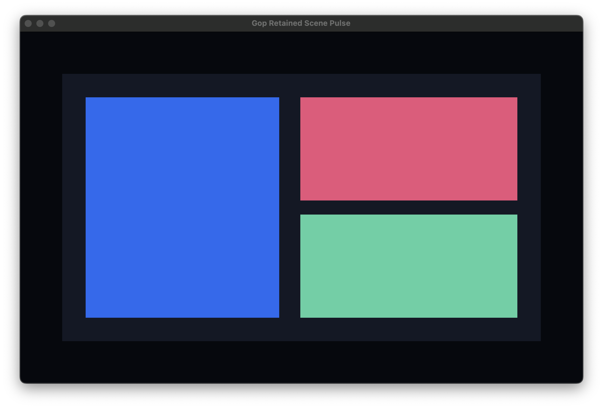
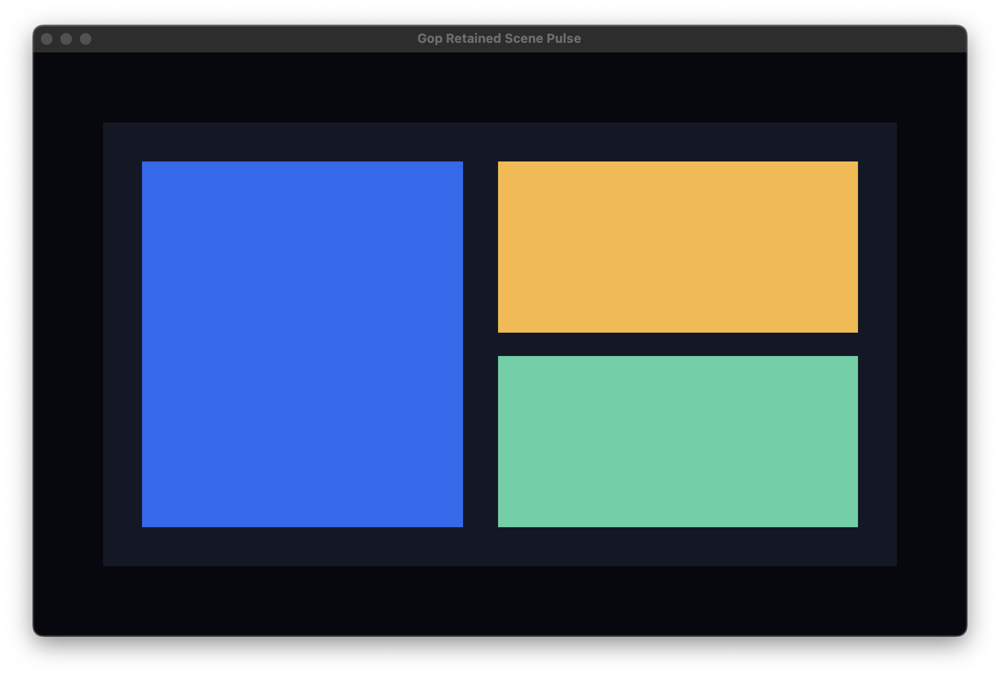

# M1 Retained Scene Baseline: macOS ARM64

Date: 2026-10-12

M1 is complete for the first macOS backend: basic retained geometry renders
through Metal, an unchanged scene performs no work, and one Go scene mutation
updates one persistent GPU instance without rebuilding or walking the full
scene.

## Environment

- Hardware: Apple M2 Pro.
- Operating system: macOS 15.5 (Darwin 24.5.0).
- Go: 1.26.5, `darwin/arm64`, CGO enabled.
- Compiler: Apple clang 17.0.0.
- GPU path: Cocoa + CAMetalLayer + precompiled Metal library.
- Build flags: `-trimpath -ldflags='-s -w -buildid='`.

## Scene Benchmarks

| Benchmark | Result | Allocations |
| --- | ---: | ---: |
| Drain unchanged 10,000-node scene | 2.012 ns/op | 0 B/op, 0 allocs/op |
| Update and drain one of 10,000 nodes | 12.39 ns/op | 0 B/op, 0 allocs/op |
| Create and publish 10,000 rectangles | 252.965 µs/op | 1,687,555 B/op, 3 allocs/op |
| Apply one scene change to retained renderer | 23.53 ns/op | 0 B/op, 0 allocs/op |

The create benchmark uses `NewWithCapacity(10001)`. Before capacity planning it
used approximately 4.58 MB, 39 allocations, and 540 µs per operation. The
current retained scene change also carries sibling identity so render backends
can preserve deterministic tree paint order.

## Native Renderer Results

| Metric | Result |
| --- | ---: |
| Stripped executable | 1,765,202 bytes |
| First scheduled frame | 327.345 ms |
| Settled CPU | approximately 0% |
| Physical footprint | 34.3 MiB |
| Peak physical footprint | 39.7 MiB |
| Metal submissions | 2 |
| Metal draw calls | 2 |
| Rectangle instances drawn | 8 total, 4 per frame |
| Initial GPU upload | 128 bytes |
| Localized GPU upload | 32 bytes |
| Full buffer builds | 1 |
| Partial buffer updates | 1 |
| Normal termination status | 0 |

The first frame includes loading the precompiled Metal library and creating the
render pipeline. No runtime shader compiler is bundled. A deterministic test
pointer event then changes one rectangle. The renderer updates exactly one
32-byte instance and submits exactly one additional frame. After that update,
the application performs no further scene work or GPU submissions.

The process footprint is higher than the earlier static M1 baseline because the
C-to-Go event callback path activates additional Go/CGO runtime state. This
remains above the provisional 15 MiB target and is tracked as an optimization
problem rather than hidden by the lower pre-callback measurement.

## Visual Evidence

The initial native frame is stored at
`docs/images/m1-retained-scene.png`.



The localized-update frame is stored at `docs/images/m1-local-update.png`. Only
the upper-right rectangle changes from pink to yellow.



## Correctness Evidence

Tests and the native harness cover:

- Repeated mutations coalescing into one final change.
- Empty drains returning no work and allocating nothing.
- Generational IDs rejecting stale handles after slot reuse.
- Recursive child-before-parent subtree deletion.
- Create-then-delete before publication producing no renderer work.
- Invalid parent rejection and permanent root ownership.
- Deterministic depth-first paint order in retained renderer state.
- One of 10,000 nodes updating one renderer instance without rebuild.
- Localized Metal upload of 32 bytes with no full buffer replacement.
- No GPU submissions after the updated scene settles.
- Native Linux and Windows builds excluding all Darwin bridge files.

## Known Limitations

- Shared Metal instance memory is not yet multi-buffered for rapid updates while
  previous frames remain in flight.
- Resize currently uses AppKit invalidation and needs explicit runtime-level
  resize events before M2 stabilizes.
- Pointer routing exposes only presses; focus, movement, scrolling, and keyboard
  input belong to M2.
- Startup and physical footprint remain above their provisional targets.

## Reproduction

```sh
./benchmarks/m1_darwin.sh
```

The script benchmarks scene and retained-renderer paths, builds the stripped
native demo, triggers one deterministic pointer update through the same native
callback used by real input, captures idle metrics, requests clean termination,
and asserts exact GPU submission and upload counters.
